  <picture>
    <source media="(prefers-color-scheme: dark)" srcset="assets/banner-dark.svg">
    <source media="(prefers-color-scheme: light)" srcset="assets/banner-light.svg">
    
  </picture>

 

  把重复劳动交给机器，把判断留给自己。

 

  <picture>
    <source media="(prefers-color-scheme: dark)" srcset="assets/divider-dark.svg">
    <source media="(prefers-color-scheme: light)" srcset="assets/divider-light.svg">
    
  </picture>

## 关于

- **Java / Spring 十年**：服务拆分、消息推送、任务调度、数据一致性，生产环境的坑基本趟过一遍。
- **微信生态**：小程序、公众号、支付都做过；也写反编译、热更这类偏门工具。
- **AI 工具链**：让 agent 真正嵌进研发流程，而不是停在 demo —— provider 插件、用量与预算护栏、会话桥接。
- 偏好**小而锋利**的工具：不改上游源码，能插进去就插进去。

## 技术栈

| 方向 | 常用 |
| :-- | :-- |
| **后端** |     |
| **端上** |    |
| **工程** |     |

## 项目

| 项目 | 说明 |
| :-- | :-- |
| **[paseo-dsh](https://github.com/liuxing7954/paseo-dsh)** | Paseo 原生 provider 插件 + DSH 桥接：提问卡片、计划模式、思考档位、插话、用量统计。不改 Paseo 源码，不 fork DSH。 |
| **[paseo-deepseek-usage](https://github.com/liuxing7954/paseo-deepseek-usage)** | 把 DeepSeek 官方余额接进 Paseo 用量面板，可选按预算百分比显示。 |
| **[wechat-ma-recode](https://github.com/liuxing7954/wechat-ma-recode)** | 微信小程序反编译工具，cursor 修复版。 |

## 现在

- 在把 DSH / DeepSeek 这条链路接成日常研发的一部分：少敲命令，多留时间想问题。
- 顺手把踩过的坑写成工具，能开源的就开源。

 

  <picture>
    <source media="(prefers-color-scheme: dark)" srcset="assets/divider-dark.svg">
    <source media="(prefers-color-scheme: light)" srcset="assets/divider-light.svg">
    
  </picture>

   
  
    
  自 2015 年 · 一直在写，也一直在拆

